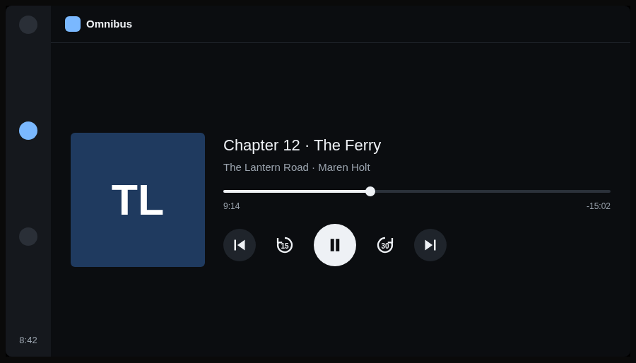
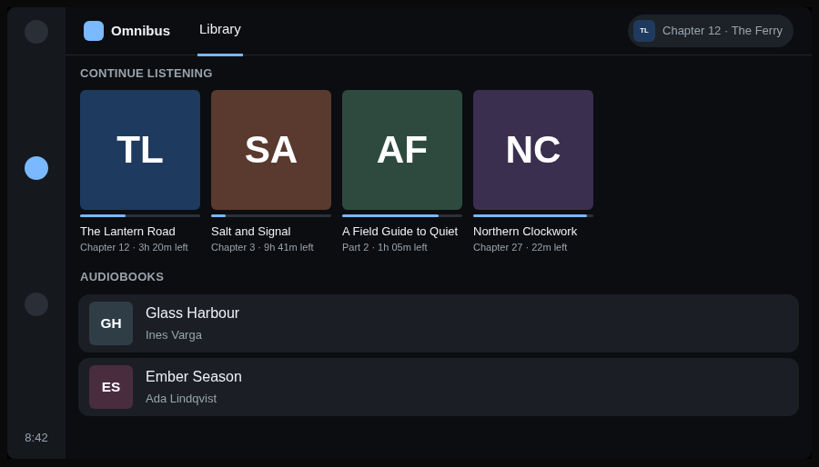
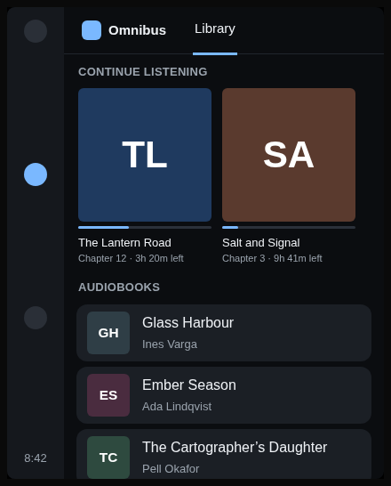
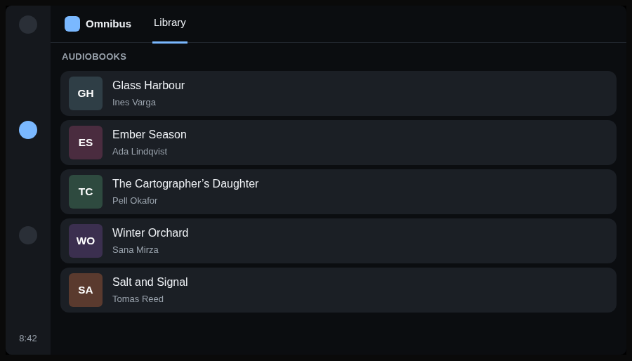
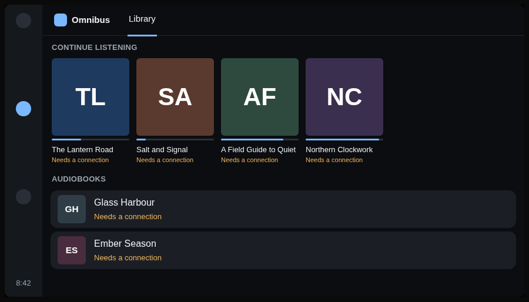
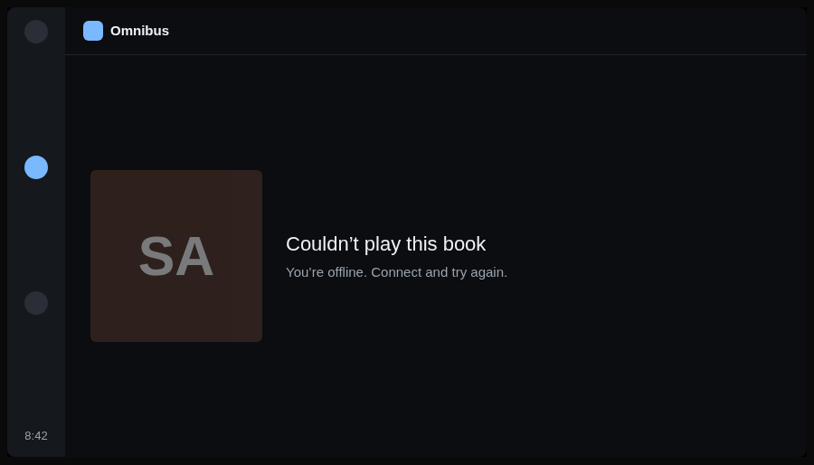
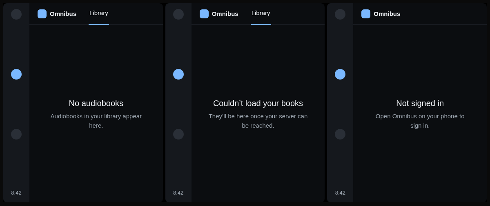

# Android Auto

| Version | Status | Last updated |
|---|---|---|
| 1.0.0 | Accepted | 2026-11-25 |

## Summary

Omnibus in Android Auto lets a listener play their audiobooks from the car's screen while the phone stays in their pocket. The car shows a Library of the listener's audiobooks, with the ones in progress first, and a Now Playing screen that controls the same playback as the phone.

## Scope

**In scope**

- Omnibus listed among Android Auto's media apps, on a phone connected to a car or to the Desktop Head Unit.
- Now Playing in the car: the current chapter, play and pause, seeking, back 15 and forward 30, and previous and next chapter.
- Resuming the most recent audiobook from the car, by the car's play button or by Android Auto's own setting to start media when the car connects.
- Taking a newer position from another device, or from the ebook, without a prompt while the car is connected.
- The Library screen: Continue listening tiles, then the other audiobooks as a list.
- Signed out, offline, empty, failed load and failed play states.

**Out of scope**

- Android Automotive OS (Android built into the car, without a phone).
- Playback speed, bookmarks, the sleep timer and a chapters list in the car.
- Voice requests to play a book.
- Browsing by series, author, shelf or tag, and searching, in the car.
- Playing a book while offline.
- Ebooks, and books with no audio.
- A side-by-side layout. Android Auto draws every media screen, and stacks sections vertically.
- Publishing to Google Play. Until Omnibus is on Play, Android Auto lists it only with its developer setting for unknown sources turned on.

## Glossary

| Term | Meaning |
|---|---|
| Car | Android Auto on a car's screen, or the Desktop Head Unit, with the phone connected. |
| Connected | Android Auto is running against the phone. The rules marked "while connected" apply then, wherever playback was started. |
| Now Playing | Android Auto's playback screen for the book that's loaded. |
| Library | Omnibus's one browse screen in the car. |
| Continue listening | The Library's first section: audiobooks in progress, as cover tiles. |
| Audiobooks | The Library's second section: every other audiobook, as rows. |
| Device offer | A newer position for the playing book from another device, which the phone's player offers in a banner. |
| Ebook offer | A position in the audiobook that matches where the listener is in the ebook, which the phone's player offers in a banner. |
| Active library | The library the phone has switched to. |

---

# Part 1: Product

Android Auto draws every screen in the car itself, always dark, and decides the exact layout from the car's screen. The renders show the content and arrangement Omnibus asks for; the chrome around it, the fonts and the button positions are Android Auto's.

## Screens

### Now Playing

- The title line is the current chapter's title, the second line the book's title and author, and the art the book's cover, the same as on the phone's lock screen. A book without a cover shows the generated plate.
- The seek bar and both times cover the current chapter, not the whole book. Seeking moves within that chapter.
- The buttons are previous chapter, back 15, play or pause, forward 30, next chapter. A book without chapters has no chapter buttons, and its seek bar covers the whole book.
- On a narrow screen Android Auto MAY move the chapter buttons into its overflow.

### Library

- Continue listening tiles show the cover, a progress bar, the title, and a progress line (see Requirements: Library).
- Audiobooks rows show the cover, the title and the author.
- The phone's Now Playing chip, the "Playing" marker and the tab header are Android Auto's.

### Library with nothing in progress

- The Continue listening section and its header are left out.

### Library offline

- Every tile and row keeps its place; only its second line changes.

### A book that couldn't play

### Messages

## States and copy

| State | When | Copy | Action |
|---|---|---|---|
| Library | Signed in, and the first read of the Library has answered with at least one audiobook. | Section headers "Continue listening" and "Audiobooks". | Tap a tile or row to play it. |
| No audiobooks | The active library has no audiobooks. | "No audiobooks" / "Audiobooks in your library appear here." | None. |
| Couldn't load | Every read of the Library failed and nothing is listed yet. | "Couldn't load your books" / "They'll be here once your server can be reached." | None. The Library reads again when the connection returns. |
| Offline | The phone has no connection. | Each tile and row's second line: "Needs a connection". | Tapping one gives Play failed. |
| Signed out | No one is signed in, or the session has expired. | "Not signed in" / "Open Omnibus on your phone to sign in." | None. |
| Play failed | A book chosen in the car couldn't be loaded. | "Couldn't play this book" / the reason: "You're offline. Connect and try again." when offline, otherwise "Your server couldn't be reached." | Choose the book again. |

## Requirements

### Listing

- Omnibus MUST appear among Android Auto's media apps whenever the phone is connected.
- Omnibus MUST NOT appear as an Android Automotive OS app.

### Now Playing

- Now Playing MUST show the book that's loaded on the phone, whether it was started from the car or the phone.
- Play, pause, seeking, back 15, forward 30 and the chapter buttons MUST act on the same playback as the phone, and the phone's player MUST show the result.
- Back 15 and forward 30 MUST move in book time, crossing chapter boundaries, as on the phone.
- Previous chapter MUST go to the start of the current chapter, or of the previous one when near its start; next chapter MUST go to the start of the next one, and MUST do nothing on the last chapter. Both MUST behave as the phone player's chapter buttons do.
- The car's hardware next and previous buttons MUST skip back 15 and forward 30, never change chapter. Why: the on-screen chapter buttons are the deliberate way to change chapter, and a steering-wheel press is easy to make by accident.
- Every button MUST have a spoken label for Android Auto's accessibility.

### Starting playback

- With nothing loaded, the car's play button MUST resume the most recent audiobook at its saved position.
- When Android Auto's own setting to start media when the car connects is on, connecting MUST resume the most recent audiobook at its saved position.
- Omnibus MUST NOT start playback because the car connected unless Android Auto asks it to. Why: Android Auto's setting is the listener's choice of whether the car starts playing.
- Disconnecting the car MUST leave playback as Android Auto leaves it; Omnibus MUST NOT stop or start playback because of it.

### Newer positions while connected

- While connected, a device offer MUST NOT be shown. Instead the player MUST jump to the newer position as soon as it's known, even if playback has started, and save the position at once, as accepting the offer on the phone does.
- While connected, an ebook offer whose position is ahead of the current one MUST be taken the same way, with no banner.
- While connected, an ebook offer whose position is behind the current one MUST NOT move playback; it stays on offer for the phone's player as it does today. Why: jumping back to a passage being re-read is rarely wanted while driving, and the car offers no way to undo it.
- After an offer is taken automatically, the phone's player MUST show no banner for it.

### Library

- The Library MUST be the only screen Omnibus offers in the car besides Now Playing, with no tabs between screens.
- The Library MUST show only audiobooks from the active library.
- Continue listening MUST list the audiobooks in progress, most recently listened first, up to the Continue limit.
- Each tile's progress line MUST read "Chapter {n} · {time} left" when the position's chapter is known with high confidence, "Part {n} · {time} left" when only the audio part is known, and "{time} left" otherwise. Time left is the book's remaining duration divided by the book's playback speed, written as "3h 20m" or "22m", the same as on the phone's Continue cards.
- Each tile's progress bar MUST show how far through the book the listener is.
- Audiobooks MUST list every other audiobook in the active library, newest added first.
- A book MUST appear at most once on the Library: a book in Continue listening MUST NOT also be in Audiobooks.
- The Library MUST stop listing at the Library limit, counting tiles and rows together.
- Tapping a tile or row MUST start that book at its saved position, or at its start when it has none, and Android Auto MUST then show Now Playing for it.
- The Library MUST update when the playing book changes, from the car or the phone, so the book just played moves to the front of Continue listening.
- The Library MUST be replaced when the active library changes or the listener signs out, and MUST NOT show another library's or account's books, even briefly.
- Once a read has answered, the Library MUST keep its tiles and rows through a later failed read rather than show Couldn't load.

### Offline

- Offline, every tile and row MUST stay listed, with its second line replaced by "Needs a connection".
- Offline, tapping a tile or row MUST give Play failed, and MUST NOT stop what is playing.
- When the connection returns, the Library MUST read again and restore each tile and row's second line.

---

# Part 2: Engineering

## Server contract

Playback, positions, offers and covers use the audiobook player's existing calls, unchanged. The Library adds two reads.

### `GET api/progress/recent`

The audiobooks in progress, for Continue listening.

| Parameter | Value |
|---|---|
| `format` | `audio`. Only listening positions are returned. |
| `limit` | The Continue limit. |

Response: one resume point per book, newest first. Fields read:

| Field | Meaning |
|---|---|
| `record.book_uuid` | The book. |
| `record.audio_position_seconds` | Where the listener is, in book seconds. |
| `record.total_duration_seconds` | The book's length, for the progress bar and time left. Nullable: with no length, the tile has no bar and no time left. |
| `record.resolved.chapter_ordinal`, `record.resolved.confidence` | The chapter for the progress line, used only when `confidence` is `high`. Nullable. |
| `audio_part`, `audio_part_count` | The part for the progress line when the chapter isn't known. Nullable. |
| `playback_rate` | The book's speed, for time left. Null means 1.0. |
| `book` | The book, with the fields below. |

### `GET api/ebooks`

One page of audiobooks, for the Audiobooks section.

| Parameter | Value |
|---|---|
| `formats` | The audiobook formats: `m4b,m4a,mp3,aac,flac,ogg,opus`. |
| `sort`, `dir` | `newest_added`, `desc`. |
| `limit` | The Library page size. |
| `cursor` | The previous page's `X-Next-Cursor`; omitted for the first page. |

The response body is the book list the phone's Library already reads. Book fields read: `uuid`, `title`, `creators`, `cover_url`. Header read: `X-Next-Cursor`, absent on the last page. The Library reads pages until the server has none left or the Library limit is reached.

### Errors

Both reads are handled the same way:

| Response | Result |
|---|---|
| No server saved, or 401 | Signed out. |
| Connection failure | Offline when the phone has no connection; otherwise Couldn't load if nothing is listed yet. |
| Any other error status, or a body that can't be read | Couldn't load if nothing is listed yet; otherwise the listed books stay. |

## Architecture

The playback layer described in the audiobook spec is reused: one `AudiobookController`, one ExoPlayer in `AudiobookPlaybackService`, wrapped in `ChapterForwardingPlayer` so every system surface sees the current chapter.

- **Service.**
  - `AudiobookPlaybackService` becomes a `MediaLibraryService`, with a `MediaLibrarySession` built on the same player and callback. The manifest's service also declares the `MediaLibraryService` and `android.media.browse.MediaBrowserService` actions, so Android Auto can find it.
  - The manifest declares `com.google.android.gms.car.application` pointing to an `automotive_app_desc.xml` that uses `media`.
- **Callback.** `AudiobookSessionCallback` becomes a `MediaLibrarySession.Callback`.
  - `onGetLibraryRoot` returns a root with one browsable child, the Library. It returns `ERROR_SESSION_AUTHENTICATION_EXPIRED` with the Signed out copy when no one is signed in.
  - `onGetChildren` returns the Library's items, built by a car library source (below).
  - `onAddMediaItems` and `onSetMediaItems` return the items Android Auto sends unchanged: a media id (the book's uuid) and no URI.
  - `onPlaybackResumption` returns one such item for the most recent audiobook, from the same source `AudiobookController.play()` uses when nothing is loaded.
- **Starting a book from the car.** `ChapterForwardingPlayer` overrides `setMediaItem`, `setMediaItems` and `addMediaItems` so they never reach the ExoPlayer. They take the first item's media id and call `AudiobookController.load(uuid, null, null, autoplay = true)`, as its `play()` already routes to `AudiobookController.play()`. Why: the engine builds the book's source itself (every audio part joined into one timeline, the signed-in HTTP client, the resume position, the book's speed) and sets it on the ExoPlayer through `PlaybackServiceBridge`. An item set by Media3 would skip all of that, and the phone's player would not know a book had changed. The app's own controller never calls these methods, so only system controllers such as Android Auto reach the override.
  - A failed load reports a `PlaybackException` carrying the Play failed copy, so Android Auto shows it on Now Playing.
- **Chapter buttons.** `ChapterForwardingPlayer` keeps hiding the next and previous commands, so the car's hardware buttons still map to skips through `RemotePressFilter`. Previous and next chapter are two more custom session commands, published as media button preferences beside back 15 and forward 30, and present only while the loaded book has chapters. They call `AudiobookController.previousChapter()` and `nextChapter()`.
- **Car library source.** A new `CarLibrarySource` in `data/audiobook/car/` builds the Library.
  - It reads `LibraryRepository.getRecentProgressFlow` with the audio format and the Continue limit, and pages `getBooksPageFlow` with the audiobook formats, dropping books already in Continue listening.
  - It is scoped to the active library and the signed-in session, as the Room database is (see `docs/engineering/local-storage.md`), and drops what it holds when either changes.
  - It calls `notifyChildrenChanged` on the Library when the playing book changes, the connection changes, or the active library or session changes.
  - It formats the progress line with the same rules as the phone's Continue cards (`ContinueCards.kt`), sharing that function rather than copying it.
- **Item styling.**
  - Continue listening items carry `MediaConstants.EXTRAS_KEY_CONTENT_STYLE_GROUP_TITLE` "Continue listening", the grid item style, and `EXTRAS_KEY_COMPLETION_PERCENTAGE` for the progress bar.
  - Audiobooks items carry the group title "Audiobooks" and the list item style.
  - Every item's media id is the book's uuid, the same id the engine gives the item it plays, so Android Auto can mark the playing book.
- **Covers.** Android Auto loads browse art by URI, and covers need the signed-in session. A new `CarCoverProvider` (a `ContentProvider`, not exported, with read permission granted to Android Auto's packages) serves the `md` cover from `CoverDiskStore`, fetching it through `CoverRepository` when it isn't on disk, and the generated plate when the book has no cover. Item artwork URIs point at it. Now Playing keeps its current artwork path.
- **Connected.** A `CarConnectionMonitor` exposes whether Android Auto is connected, from `androidx.car.app.connection.CarConnection` (`CONNECTION_TYPE_PROJECTION`). It is a new dependency on `androidx.car.app:app`, added through the version catalog.
- **Offers.** `DefaultResumeOffers` reads `CarConnectionMonitor`. While connected, it accepts a device offer as soon as it arrives, and an ebook offer when it is ahead, through the same paths as `acceptDeviceOffer` and `acceptEbookOffer`, so neither reaches `getOffersFlow`. A behind ebook offer is left as it is today.
- **Reuse.**
  - `AudiobookController` for every playback command.
  - `BookAvailability` and `ConnectivityMonitor` for the offline state.
  - `ArtworkPlate` for books with no cover.

## Constants

| Name | Value | Meaning |
|---|---|---|
| Continue limit | 12 | Most audiobooks in Continue listening. |
| Library page size | 60 | Books per `api/ebooks` page, the phone Library's page size. |
| Library limit | 200 | Most tiles and rows the Library lists in all. Android Auto MAY show fewer while the car is moving. |
| Skip back | 15 s | Back 15, in book time. |
| Skip forward | 30 s | Forward 30, in book time. |
| Browse cover size | `md` (320×480) | The cover size served to Android Auto's browse screens. |

---

## Changelog

**1.0.0** (2026-11-25)

- Initial spec.
