# Series Details

| Version | Status | Last updated |
|---|---|---|
| 1.0.0 | Accepted | 2026-11-25 |

## Summary

Series Details is the page for one series. It lists every book in the reader's library that belongs to the series, in reading order. Where the series numbering skips a book, a placeholder row marks the gap, so the reader can see what's missing at a glance.

## Scope

**In scope**

- The Series Details page: its title, count line, book rows, placeholder rows, and every loading, empty and error state.
- Opening the page from the "Series page" links in Book Details, the Library and Shelf Detail, and from series rows in Search.
- Pull to refresh.
- Phones, and wide windows from 600dp.
- The light and dark themes.

**Out of scope**

- Reading progress, read status, or continue and play buttons on the page or its rows.
- Requesting a missing book from a placeholder row.
- Hiding or showing the series on Home.
- A long-press menu on rows, including editing a book's metadata.
- Sort and filter controls.
- A cover collage, description or other series header beyond the title and count line.
- A list of every series (a Series index).
- Missing books after the highest whole number the library holds, and missing fractional numbers.
- Viewing the page offline, or without the server.

## Glossary

| Term | Meaning |
|---|---|
| Series number | The book's position in the series as the server sends it, such as "3" or "2.5". A book may have none. |
| Whole number | A series number that is a whole number of 1 or more, such as "3" or "3.0". |
| Book row | A row for a book in the library. |
| Placeholder row | A row standing in for one or more whole numbers that no book in the library holds. |
| Gap | A run of consecutive whole numbers, from 1 up to the highest whole number held, that no book holds. |
| Count line | The line under the title giving the series' author and how many books the library holds. |

---

# Part 1: Product

## Screens

### Series Details

| Dark | Light |
|---|---|
| 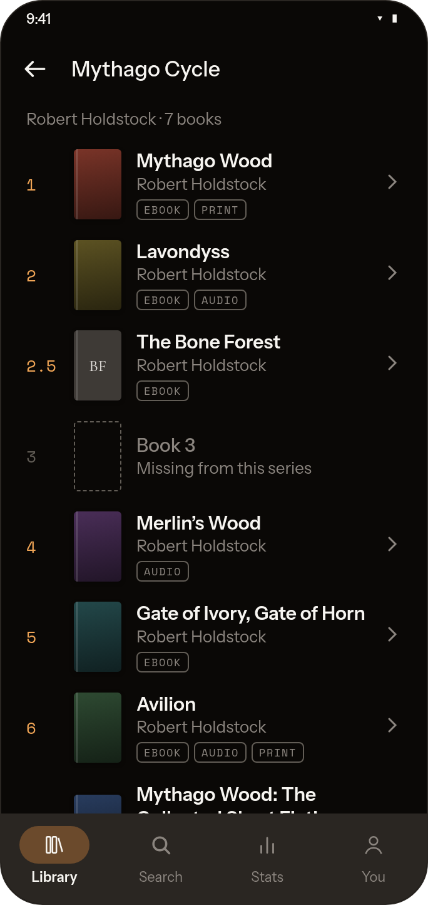 | 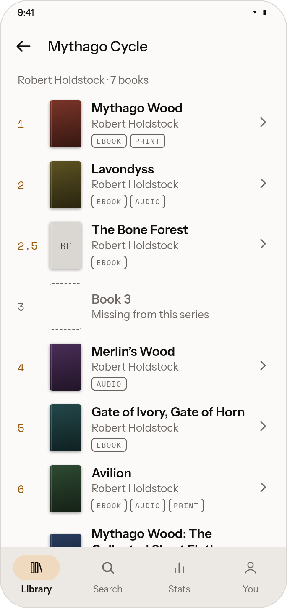 |

- The top bar shows the back button and the series name. The count line sits under it and scrolls with the list.
- The count line reads "‹author› · N books". The author is the first author of the first book row. "1 book" is singular, and a missing author drops "‹author› · ".
- N counts only books in the library. Placeholder rows are not counted.

### Rows

| Dark | Light |
|---|---|
| 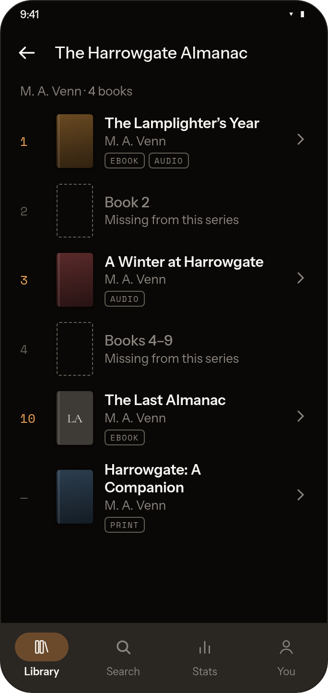 | 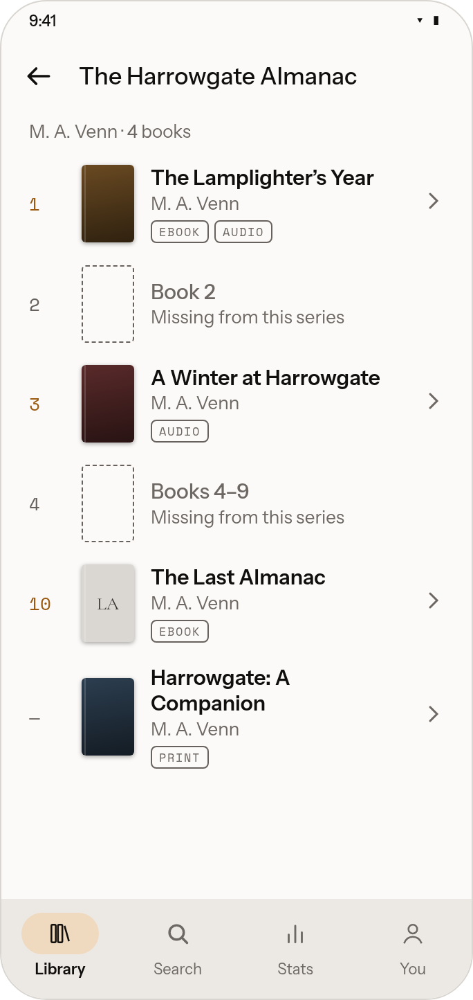 |

| Row | Number column | Leading | First line | Second line | Third line |
|---|---|---|---|---|---|
| Book | Series number, in the accent colour; "—", muted, when the book has none | Cover | Title | Authors | Format badges |
| Placeholder, one number | The number, muted | Dashed empty cover | "Book ‹n›" | "Missing from this series" | None |
| Placeholder, range | The first number of the range, muted | Dashed empty cover | "Books ‹first›–‹last›" | "Missing from this series" | None |

- A book with no cover gets the app's generated cover plate.
- The series number is shown as the server sends it ("2.5", not "Book 2.5" or "Vol. 2.5").
- Format badges follow the same rules as Search's book rows: EBOOK when the book has any ebook format, AUDIO when it has any audio format, and PRINT when the library has a physical copy, in that order and each at most once.
- Placeholder rows have no chevron and do nothing when tapped.

### Wide windows

| Dark | Light |
|---|---|
| 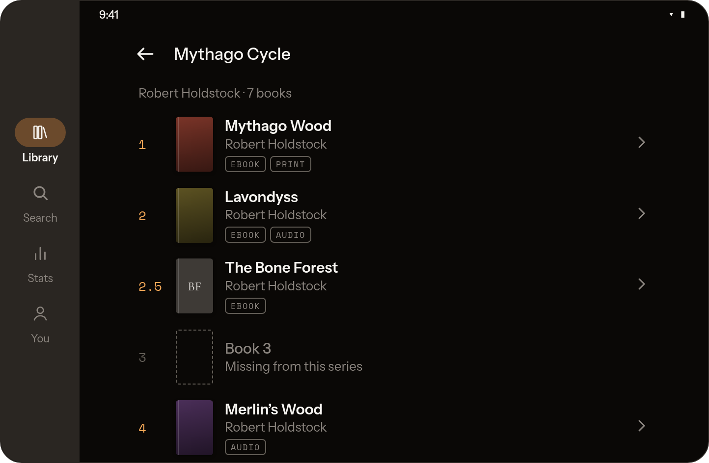 | 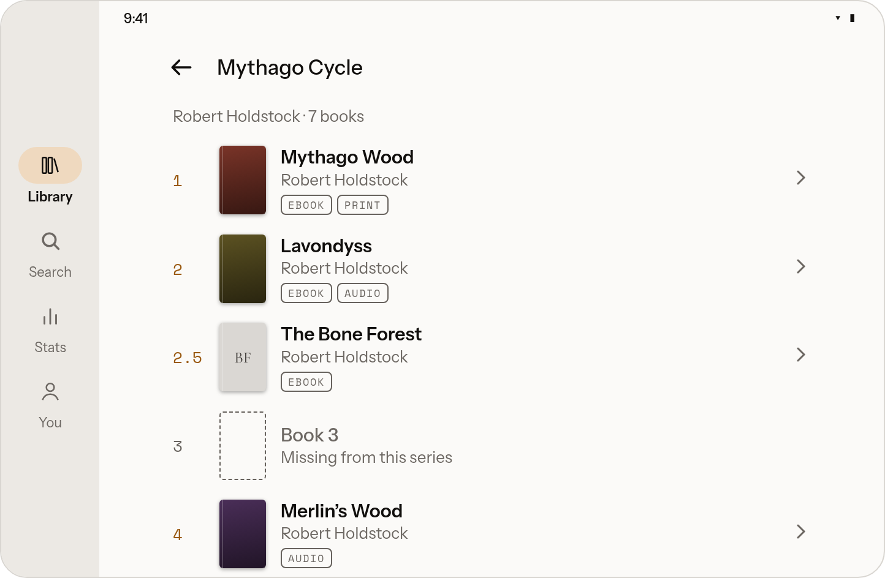 |

- From 600dp the app shows its navigation rail. The page is one column, at most 560dp wide, centred in the space beside the rail.

### Loading and errors

| Loading | Can't reach server | Something went wrong |
|---|---|---|
| 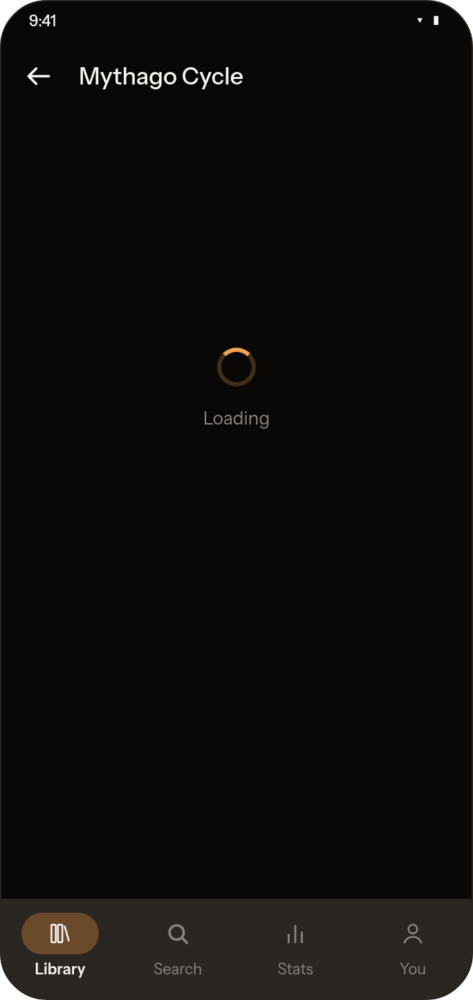 | 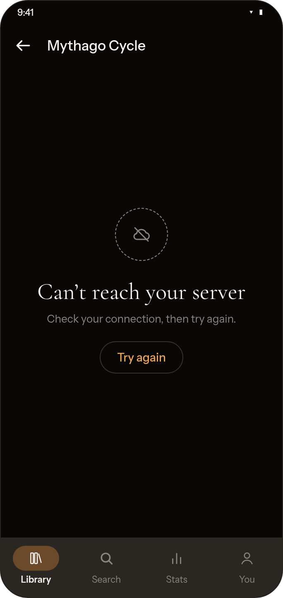 | 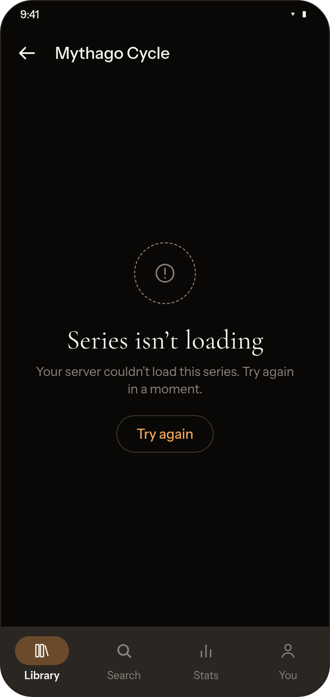 |
| 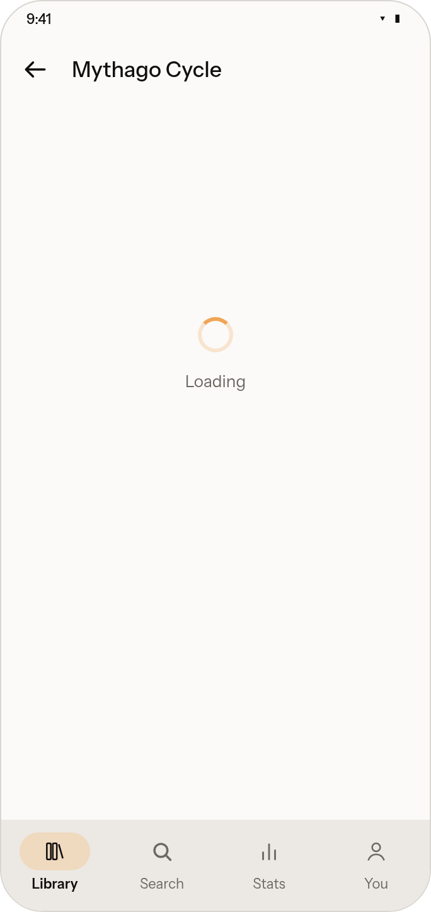 | 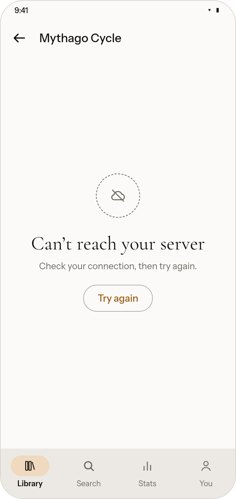 | 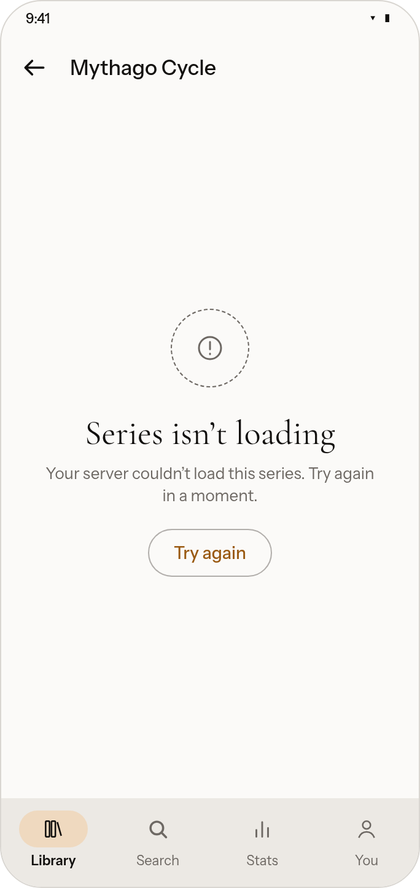 |

| Not found | Empty | Refresh failed |
|---|---|---|
| 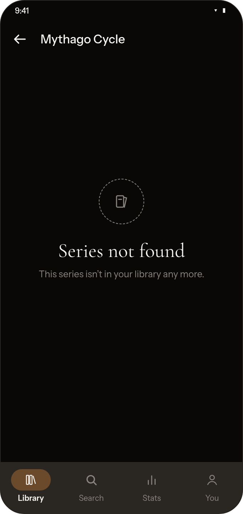 | 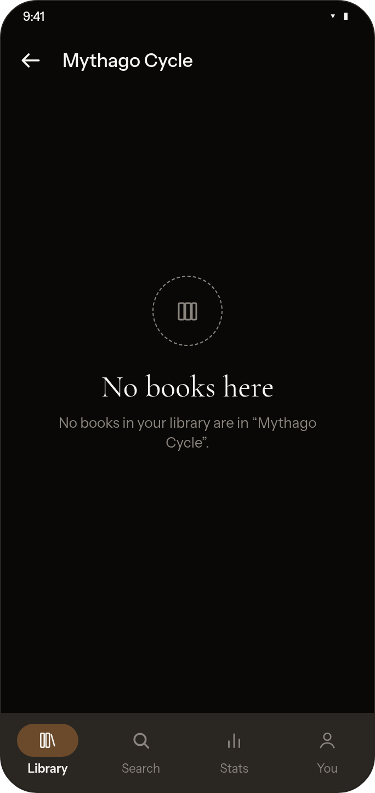 | 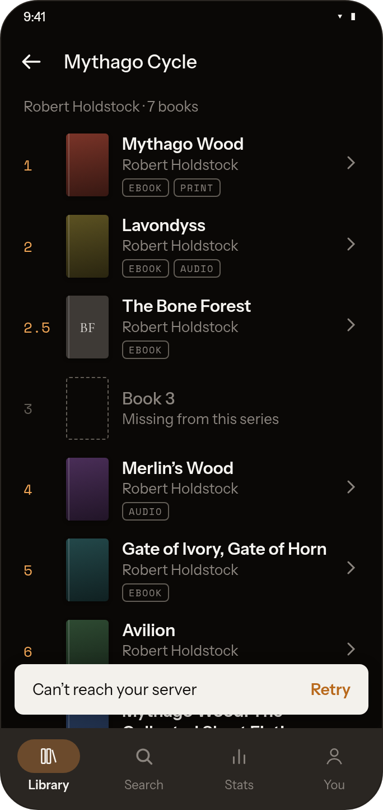 |
|  | 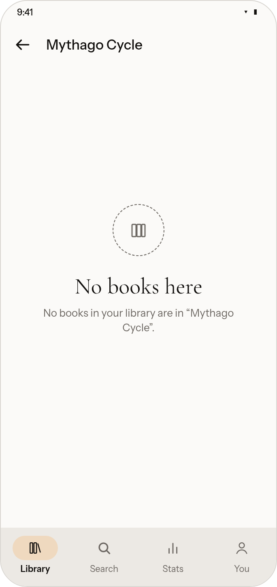 | 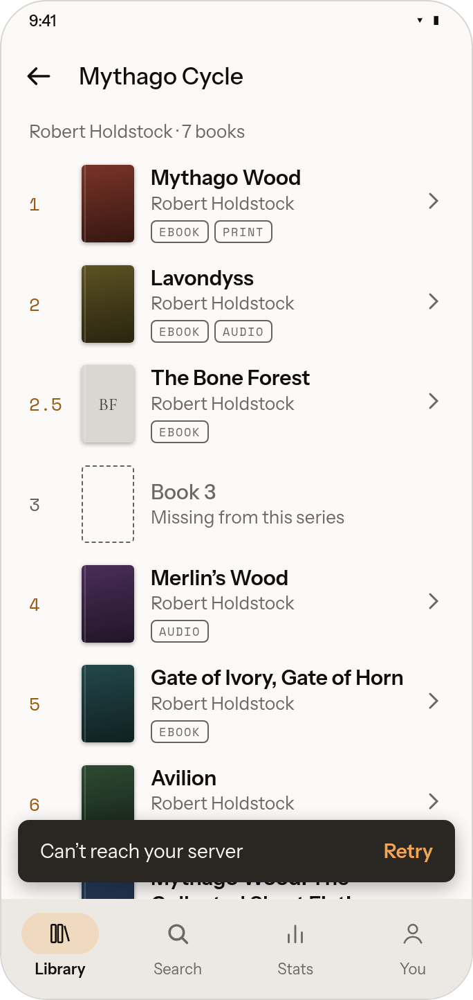 |

- The top bar shows the series name in every state, including Loading and the errors. The count line shows only once the series has loaded.

## States and copy

| State | When | Copy | Action |
|---|---|---|---|
| Loading | The series is loading and nothing is on screen. | "Loading" | None |
| Loaded | The series has at least one book. | Count line: "‹author› · N books". Placeholder rows: "Book ‹n›" or "Books ‹first›–‹last›", then "Missing from this series". | Tap a book row. Pull to refresh. |
| Empty | The series has no books in the library. | Title: "No books here". Body: "No books in your library are in "‹name›"." | Pull to refresh. |
| Not found | The server has no series with this id. | Title: "Series not found". Body: "This series isn't in your library any more." | None |
| Can't reach server | Loading failed because the server couldn't be reached, and nothing is on screen. | Title: "Can't reach your server". Body: "Check your connection, then try again." Button: "Try again". | "Try again" loads again. |
| Something went wrong | Loading failed for any other reason (an error status, a response the app can't read), and nothing is on screen. | Title: "Series isn't loading". Body: "Your server couldn't load this series. Try again in a moment." Button: "Try again". | "Try again" loads again. |
| Can't reach server, with books | A refresh failed because the server couldn't be reached, and books are on screen. | Snackbar: "Can't reach your server". Action: "Retry". | "Retry" refreshes again. |
| Something went wrong, with books | A refresh failed for any other reason, and books are on screen. | Snackbar: "Series isn't loading". Action: "Retry". | "Retry" refreshes again. |
| Session expired | The server answered that the session has expired. | The app's existing session-expired handling. | The reader signs in again. |

## Requirements

### Opening the page

- Tapping "Series page" in a Book Details series fan, on an unfolded Library series, or on a series in Shelf Detail MUST open that series' page.
- Tapping a series row in Search MUST open that series' page.
- A "Series page" link MUST NOT show when the app doesn't know the series' id. Why: the page is loaded by id.
- The page MUST open within the tab it was opened from, so Back returns to the previous page unchanged.
- The page MUST show the series name in the top bar from the moment it opens, before the series has loaded.
- Opening "Series page" from a Book Details page reached from this page MUST open another Series Details page on top. The app MUST NOT try to detect or collapse the repeat.

### Book rows

- The page MUST list every book the server returns for the series, in the server's order: series number ascending, books with no number last, then by title.
- Books that share a series number MUST all be shown, each with that number.
- The page MUST list every book in the series even when the series is hidden from Home.
- The page MUST NOT sort or filter the books, and MUST have no sort or filter controls.
- Rows MUST show the content set out in [Rows](#rows).
- Tapping a book row MUST open its Book Details page.
- The title MUST wrap to at most 2 lines and then end in an ellipsis. The authors MUST fit on 1 line and then end in an ellipsis.

### Placeholder rows

- The page MUST show a placeholder for each whole number from 1 up to the highest whole number any book holds, where no book holds that whole number.
- A book with a fractional series number (such as "2.5") MUST NOT fill a gap and MUST NOT create one.
- A book with no series number, or with a series number that isn't a number, MUST NOT fill or create a gap.
- The page MUST NOT show placeholders after the highest whole number held. Why: the server only knows the books in the library, so the app can't know how long the series is.
- A gap of 1 to 3 numbers MUST show one placeholder row per number. A gap of more than 3 numbers MUST show a single range placeholder row covering the whole gap. Why: some series number their books by year, and hundreds of placeholder rows would bury the books.
- Placeholder rows MUST sit where their numbers fall in the order, after any book with a lower number (including fractional ones) and before the next book.
- Placeholder rows MUST NOT respond to taps or long presses.
- A series with no whole numbers MUST show no placeholder rows.

### Count line

- The count line MUST count only the books in the library, never placeholders.
- The count line MUST follow the wording in [Series Details](#series-details-1).

### Loading and refreshing

- The page MUST load the series each time it opens. Returning to it with Back MUST NOT reload it.
- Pulling down at the top of the list MUST refresh the series.
- A failed refresh MUST NOT remove the books on screen. It MUST show the matching "with books" snackbar instead.
- A refresh that finds the series gone MUST show the Not found state.
- The page MUST show each state in [States and copy](#states-and-copy) when its condition holds, with its exact copy.

### Wide windows

- From 600dp, the page MUST be one column, at most 560dp wide, centred beside the navigation rail.

### Accessibility

- The series name in the top bar MUST be a heading.
- Each row MUST be one focusable element. A book row MUST announce its number, title, authors and formats, for example "Book 2, Lavondyss, Robert Holdstock, ebook, audio". A book with no number MUST drop the "Book ‹n›" part.
- A placeholder row MUST announce as "Book 3, missing from this series", or "Books 4 to 9, missing from this series" for a range.
- Every touch target MUST be at least 48dp.
- Rows MUST grow to fit their text at the largest font scale instead of clipping it.

---

# Part 2: Engineering

## Server contract

### `GET api/series/{id}`

Returns one series and the books in it. Requires a signed-in session.

| Parameter | Value |
|---|---|
| `id` | The series' id, in the path. |

Response fields read:

| Field | Meaning |
|---|---|
| `name` | The series' name. It replaces the name the page opened with. |
| `books[]` | The books in the library that belong to the series, in series order. Each is the book object the Library already reads; this feature uses `id`, `unique_identifier`, `filename`, `title`, `creators[]`, `series_index` (nullable string), `cover_url` (nullable), `accent` (nullable), `formats[]` and `has_physical`. |

The server orders `books` by series number ascending with missing numbers last, then by title sort, then by id. A reader's own series-number override wins over the file's. The server writes whole numbers without a decimal ("1", not "1.0") and keeps fractions ("1.5"). It returns at most 1,000 books. It returns every book whether or not the series is hidden from Home. It returns only books in the library, never wishlist-only books.

The fields `sort`, `book_count`, `reading` and `hidden_from_home` are ignored.

### Errors

| Response | Result |
|---|---|
| No server saved | Session expired. |
| Connection failure | Can't reach server. |
| 401 | Session expired. |
| 404 | Not found. |
| 429, other error status, or a body that can't be read | Something went wrong. |

## Architecture

The feature follows the layers in `docs/engineering/feature-layers.md`, and its shape follows Shelf Detail.

- **Data.**
  - `SeriesRepository.getSeries` returns the series' name and its books as `Book`s, decoded with the Library's book decoder, instead of `SeriesMember`s. Its existing `NotFound` error maps to the Not found state.
  - The Book Details series fan reads the same result.
- **Domain.**
  - A pure function turns the ordered books into the page's entries: book entries, and placeholder entries for single numbers and ranges, following [Placeholder rows](#placeholder-rows).
  - The count line's author and count come from the books.
- **UI.**
  - `SeriesDetailsScreen` and `SeriesDetailsViewModel`, with the ViewModel created per series id.
  - The ViewModel owns loading, refreshing, keeping the books through a failed refresh, and the one-shot snackbar.
- **Routes.**
  - `SeriesDetailsRoute(seriesId, name)` serves the page.
  - `BookDetailDestination.Series` maps to it instead of the placeholder page.
  - The Library's and Shelf Detail's `onOpenSeries` pass the series id through to the route.
  - Search's series rows dispatch `BookDetailDestination.Series`.
  - The route is pushed onto the stack of the tab it was opened from.
- **Reuse.**
  - `BookCover` with `CoverIdentity` for covers and the generated plate.
  - The format badges from Search's book rows.
  - `LoadingStateView`, `EmptyStateView` and `ErrorStateView` for full-screen states.
  - `PullToRefreshBox` for pull to refresh, as in Shelf Detail and the Library.
  - The navigation rail's existing 600dp breakpoint for wide windows.

## Constants

| Name | Value | Meaning |
|---|---|---|
| First filled number | 1 | The lowest whole number a placeholder can stand for. |
| Longest separate gap | 3 | The most missing numbers in a row that get one placeholder row each. A longer gap gets one range row. |
| Content width | 560dp | Widest the page grows on wide windows. |
| Wide breakpoint | 600dp | Window width from which the rail and the capped column apply. |

---

## Changelog

**1.0.0** (2026-11-25)

- Initial spec.
