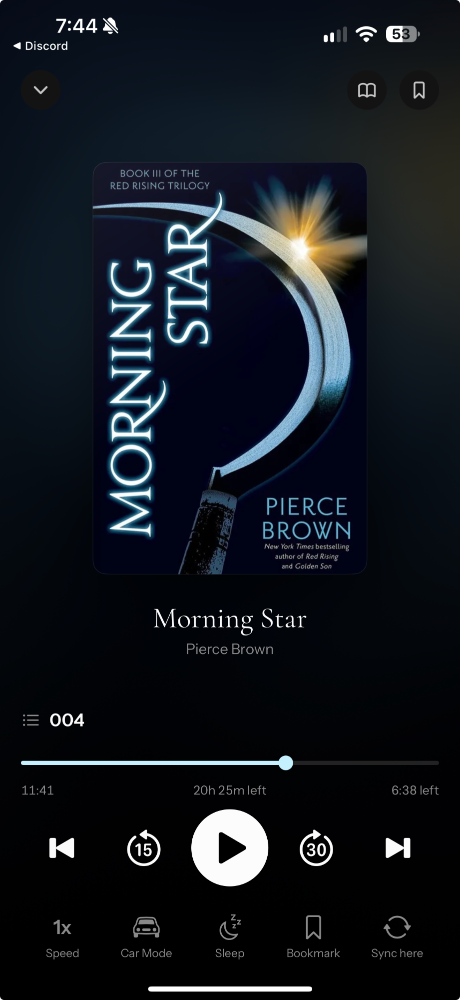
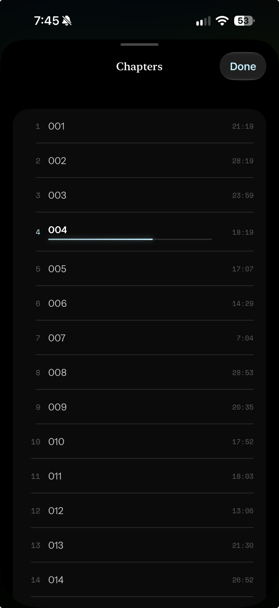
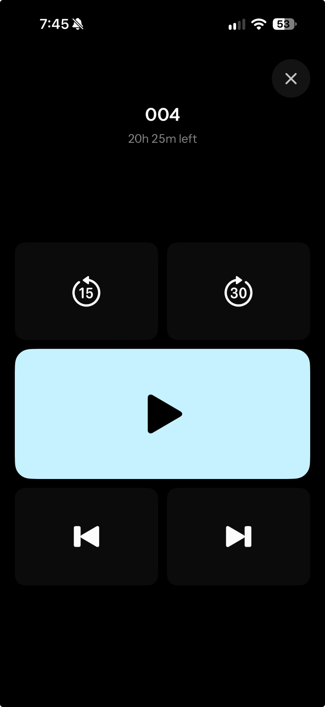

# Audiobook Spec

| | |
|---|---|
| Status | Draft |
| Epic | #91 |
| Sub-issues | #163 – #172 |
| Behavioural reference | iOS `omnibus-ios/omnibus/Features/Player/` at `origin/main` 9243d40c |
| UI reference | iOS screenshots in [`images/audiobook/`](images/audiobook/): player, chapters sheet, car mode |

## About this spec

This file is the source of truth for audiobook work. Tickets, plans and PRs point here. When code and this spec disagree, one of them is wrong: fix the code, or change the spec in the same PR and say why.

It has two parts:

- **Part 1, Product:** what the listener sees and can do. It covers screens, copy, behaviour, edge cases and acceptance criteria, and says nothing about how they are built.
- **Part 2, Implementation:** how it is built.
  - **General** decisions hold for every client: the endpoints, the timeline model, the algorithms and the constants.
  - **Platform** subsections (Android, iOS) hold only what is specific to one client.

**IDs.** Every requirement has a stable ID whose prefix says where it lives.

| Prefix | Part |
|---|---|
| `P-<AREA>-n` | Product |
| `I-<AREA>-n` | Implementation, general |
| `AND-<AREA>-n` | Implementation, Android |
| `IOS-<AREA>-n` | Implementation, iOS |

Cite IDs in tickets, test names and PR descriptions. Never renumber one. A dropped requirement is marked *Withdrawn* and left in place.

**Wording.** "Must" is required. "Should" is the default, and departing from it needs a reason in the PR.

### Glossary

| Term | Meaning |
|---|---|
| Book time | Seconds from the start of the whole audiobook, across every part. The only position unit clients store or send. |
| File | One audio edition of a book, identified by `book_file_id`. A book can have several. They don't share a timeline, so a position belongs to one file. |
| Part | One audio file inside a multi-part file (a manifest's `parts[]`). Parts are joined into one timeline. |
| Chapter | A manifest chapter: ordinal, title, start and length, all in book time. |
| Span | The current chapter, or the whole book when there are no chapters. Scrubbers and the system seek bar cover the span. |
| Rate | The playback speed, 0.5×–3.0×. |
| Settled | The point after resume has chosen a starting position. Nothing is saved before it. |

---

# Part 1: Product

## 1. Scope

**In scope**

- Listening in the background, with the notification, lock screen and headset controls.
- Resuming at the right place on any device.
- Listening stats and read status.
- The player screen, chapters, speed, the sleep timer, car mode, bookmarks, "Sync here", the mini player and the reader dock.

**Out of scope**

- In-car platforms (Android Auto, CarPlay).
- The home-screen widget.
- Downloading audiobooks (#113).
- The Listen and Immersive read buttons on Book Detail (#99). This feature provides the entry points they open.
- Linking ebook and audiobook positions (#115).

## 2. Listening and controls (#163)

**Requirements**

- P-PLAY-1. Playback continues with the app in the background and the screen off.
- P-PLAY-2. The system media controls (notification, lock screen) show the chapter title, the author, the cover, back 15, play/pause, forward 30, and a seek bar over the span.
- P-PLAY-3. **Skip.** Back is 15 s and forward is 30 s everywhere. These are fixed, not settings.
- P-PLAY-4. **Previous chapter** restarts the current chapter when more than 3 s into it, or when in chapter 1. Otherwise it goes to the start of the previous chapter.
- P-PLAY-5. **Next chapter** goes to the start of the next chapter.
- P-PLAY-6. Headset and Bluetooth next and previous skip forward 30 and back 15. They never change chapter.
- P-PLAY-7. A phone call pauses playback. It resumes afterwards only if the system says to.
- P-PLAY-8. Unplugging headphones or losing Bluetooth pauses playback. Connecting a new output does nothing.
- P-PLAY-9. A failed stream recovers on its own when it can. When it can't, the listener sees "Playback stopped and could not be resumed. Tap play to try again." with "Retry".
- P-PLAY-10. Load failures show one of:
  - "No audio parts."
  - "Could not build the audio timeline."
  - "An audio part could not be read."
  - the server's message.

**Edge cases**

- A book with several files plays the file the listener chose, else the one they were last in, else the first.
- A book with no chapters has no chapter controls. Its span is the whole book.
- Skips stop at the start and end of the book.
- Next chapter does nothing on the last chapter.
- Pressing pause while a book is still loading stops it from starting.
- Rapid repeated headset presses in the same direction within 1 s count as one.

**Acceptance criteria**

- P-PLAY-AC1: Playback continues with the screen off and the app in the background.
- P-PLAY-AC2: A multi-part book plays across part boundaries with no gap.
- P-PLAY-AC3: The lock screen shows the chapter, author and cover, with back 15, play/pause, forward 30 and a chapter seek bar.
- P-PLAY-AC4: Bluetooth next and previous skip 30 and 15.
- P-PLAY-AC5: Unplugging headphones pauses; a call pauses and resumes only when the system says to.
- P-PLAY-AC6: A stream that keeps failing stops with the retry message, and play tries again.

## 3. Resume and sync (#164, #166)

**Requirements**

- P-SYNC-1. Opening a book resumes where the listener last stopped, on this device or another.
- P-SYNC-2. Opening the player from a bookmark starts at the bookmark, not at the saved place.
- P-SYNC-3. The place is saved while listening, and at once on pause, leaving the app, finishing and closing. A place saved offline reaches the server when the connection returns.
- P-SYNC-4. Listening time counts towards stats as real time: an hour of audio at 2× is 30 minutes of listening.
- P-SYNC-5. The first play marks the book as reading. Reaching the end marks it finished.
- P-SYNC-6. **Another device further on.** If the listener has got further on another device and the player didn't learn it in time to start there, a banner offers it: "Listened further elsewhere" / "Another device left off at {h:mm:ss}." with "Go" and "Dismiss".
- P-SYNC-7. **Ebook further on.** If the listener has read further in the ebook, a banner offers it: "Read further in the ebook" / "Your reading maps to about {h:mm:ss}." When they are re-reading an earlier part of the ebook, the heading is "Re-reading earlier in the ebook" instead. If they have turned on "follow", the player moves there with no banner.
- P-SYNC-8. Only one banner shows at a time, in this order: an error, then the other-device offer, then the ebook offer.

**Edge cases**

- A saved place in a different file of the same book is ignored.
- A saved place within the first second is treated as the start.
- Opening a book never overwrites a newer saved place with 0, even when the network is slow.
- Dismissing the device offer is final for that session.
- Dismissing the ebook offer keeps it away until the ebook position changes.

**Acceptance criteria**

- P-SYNC-AC1: A book resumes where it stopped, after listening on this device or another.
- P-SYNC-AC2: A bookmark opens the player at the bookmark.
- P-SYNC-AC3: Pausing or closing saves the place at once; a place saved offline syncs later.
- P-SYNC-AC4: Listening further on another device and then opening the book late shows the device offer, and Go jumps there.
- P-SYNC-AC5: Reading further in the ebook shows the ebook offer; with follow on, the player moves there silently.
- P-SYNC-AC6: A dismissed ebook offer stays away until the ebook moves on.

## 4. Player screen (#165)



*UI reference: the iOS player.*

**Requirements**

- P-SCR-1. Book Detail's Listen and a Continue card's Play open the player on that book.
- P-SCR-2. **Offline.** If the audiobook isn't downloaded and there's no connection, a dialog shows instead of the player:
  - Title: "Can't play offline"
  - Message: "“{title}” isn't downloaded to this device, and the server can't be reached. Connect to the internet to stream it, or download the audiobook while you're online to listen anywhere."
  - When the player doesn't know the book's title, the message starts "This audiobook isn't downloaded to this device…".
  - A book already loaded in the player is exempt, so the player still opens from the mini player while offline.
- P-SCR-3. **Background.** A dark wash of the book's cover, with a soft glow in its colour.
- P-SCR-4. **Top bar.**
  - Left: a round chevron-down button that collapses the player.
  - Right: a moon pill with the sleep countdown, only while a timer runs.
  - Right: a round book button, only when the book has an ebook.
  - Right: a round bookmarks button.
- P-SCR-5. **Cover.**
  - Centred, with rounded corners, as large as the space allows without crowding the controls.
  - It eases slightly smaller (94%) when paused.
- P-SCR-6. **Titles.** The book title in the display serif, up to 2 lines, then the author in secondary text on 1 line.
- P-SCR-7. **Chapter row.** A list icon and the current chapter's title. Tapping it opens the chapters sheet.
- P-SCR-8. **Scrubber.**
  - It covers the span: a thin accent track with a round thumb that grows while dragged.
  - Tap or drag; it seeks on release.
- P-SCR-9. **Scrubber labels.**
  - Left: time into the span, as `m:ss` or `h:mm:ss`.
  - Centre: whole-book time left at the current speed, as "20h 25m left".
  - Right: span time left at the current speed, as "6:38 left".
- P-SCR-10. **Transport.** Previous chapter, back 15, a large white play/pause disc, forward 30, next chapter. Each press gives a light haptic.
- P-SCR-11. **Tool row.** Five labelled icon buttons: Speed (whose icon is the rate, such as "1x"), Car Mode, Sleep, Bookmark, Sync here.
- P-SCR-12. **States.**
  - "Preparing audio" over the cover while loading.
  - "Buffering" while stalled.
  - A banner above the cover for errors and offers (P-SYNC-8).
- P-SCR-13. **Dismiss.** Back, or a downward swipe on the cover and titles (not the controls). A short drag springs back.

**Edge cases**

- No chapters: the chapter row and the centre label are hidden, the scrubber covers the whole book, and both chapter buttons are disabled.
- Last chapter: next chapter is disabled.
- Under 1 s left in the span: the right label reads "0:00 left".
- The time-left labels change with the speed: at 2×, "6:38 left" becomes "3:19 left".
- A book with no ebook hides the book button and "Sync here".
- With animations turned off, a short dismiss drag snaps back instead of springing.
- If the book is unloaded while the player shows it (stopped from the notification, or another book loads), the player closes.

**Acceptance criteria**

- P-SCR-AC1: Listen and Play open the player instead of the placeholder.
- P-SCR-AC2: The screen shows, in order, the cover, title, author, chapter row, scrubber, transport and tool row, matching the reference.
- P-SCR-AC3: The scrubber covers the current chapter, and its labels follow the speed.
- P-SCR-AC4: The transport follows P-PLAY-3–5, with next disabled on the last chapter.
- P-SCR-AC5: A book with no chapters hides the chapter row, and its scrubber covers the whole book.
- P-SCR-AC6: Offline with no download, the "Can't play offline" dialog shows.

## 5. Chapters sheet (#167)



*UI reference: the iOS chapters sheet.*

**Requirements**

- P-CHP-1. A full-height sheet with a drag handle, the title "Chapters" in the display serif, and a "Done" pill at the top right in the accent colour.
- P-CHP-2. Rows sit in one rounded card with dividers. Each row has:
  - the 1-based number, mono and secondary;
  - the title, up to 2 lines;
  - the length on the right, mono and secondary.
- P-CHP-3. On the current row, the number is in the accent colour and the title is semibold. A thin accent line under the title shows progress through the chapter, and it moves while playing.
- P-CHP-4. The sheet opens with the current chapter centred.
- P-CHP-5. Tapping a row plays from that chapter's start and closes the sheet.

**Edge cases**

- A book with no chapters has no chapter row, so the sheet can't be opened.
- A long title wraps to 2 lines, then ends in an ellipsis.

**Acceptance criteria**

- P-CHP-AC1: The chapter row opens the sheet scrolled to the current chapter.
- P-CHP-AC2: Rows show the number, title and length; the current row is highlighted with live progress.
- P-CHP-AC3: Tapping a row plays from that chapter and closes the sheet.

## 6. Playback speed (#168)

**Requirements**

- P-SPD-1. The Speed button shows the rate ("1x", "1.25x") and opens a half-height sheet titled "Playback speed", with the current rate as "{0.00}×".
- P-SPD-2. A 4-column grid of presets: 0.5, 0.8, 1.0, 1.1, 1.2, 1.5, 1.8, 2.0, shown as "{0.0}×". The selected preset is filled.
- P-SPD-3. A "Fine-tune" slider labelled "0.5× — 3.0×", in 0.05 steps. It changes the speed while dragging.
- P-SPD-4. −/+ buttons with the caption "0.05 steps".
- P-SPD-5. Each book remembers its own speed, on every device and offline.
- P-SPD-6. The voice keeps its pitch at any speed.

**Edge cases**

- The speed can't go below 0.5× or above 3.0×.
- If saving the speed fails, the book keeps playing at the new speed.

**Acceptance criteria**

- P-SPD-AC1: A preset changes the speed at once, and the button shows it.
- P-SPD-AC2: The slider and −/+ move in 0.05 steps within 0.5–3.0.
- P-SPD-AC3: Reopening the book on any device plays at its saved speed.

## 7. Sleep timer (#169)

**Requirements**

- P-SLP-1. The Sleep button opens a sheet with a two-column grid: "Off", "15 min", "30 min", "45 min", "1 hour", "2 hours", "3 hours", "4 hours", and "End of chapter {n}".
- P-SLP-2. A timed option pauses playback when it runs out, with no fade. It counts real time, whatever the speed.
- P-SLP-3. "End of chapter" pauses at the end of the chapter that was current when it was set.
- P-SLP-4. While a timer runs, the sheet header shows "{h:mm:ss} remaining" and the player's top bar shows the moon pill.
- P-SLP-5. "Off", or picking a new option, replaces the timer.

**Edge cases**

- Switching books cancels the timer.
- The timer keeps running with the screen off and the app in the background.
- A book with no chapters has no "End of chapter" option.

**Acceptance criteria**

- P-SLP-AC1: A 15-minute timer pauses 15 minutes later, with the app in the background.
- P-SLP-AC2: "End of chapter" pauses at the end of that chapter.
- P-SLP-AC3: The countdown shows while it runs; "Off" removes it.

## 8. Car mode (#170)



*UI reference: iOS car mode.*

**Requirements**

- P-CAR-1. Opened from the tool row: a full-screen view on black.
- P-CAR-2. **Top.**
  - A round ✕ at the top right.
  - The chapter title (else the book title), centred and bold, up to 2 lines.
  - Whole-book time left at the current speed, as "20h 25m left", in secondary text.
- P-CAR-3. **Tiles**, filling the lower part of the screen:
  - Back 15 and forward 30, side by side, in dark tiles.
  - Play/pause, full width and taller, filled in the accent colour with a black icon.
  - Previous and next chapter, side by side, in dark tiles.
- P-CAR-4. The tiles follow P-PLAY-3–5.
- P-CAR-5. The screen stays on while car mode is open.
- P-CAR-6. The ✕ and back return to the player.

**Edge cases**

- No chapters: the chapter tiles are disabled.
- The tiles scale with the screen, filling a small phone and a large one alike.

**Acceptance criteria**

- P-CAR-AC1: Car mode shows the chapter, the time left and the five tiles, matching the reference.
- P-CAR-AC2: Each tile does what its counterpart on the player does.
- P-CAR-AC3: The screen doesn't sleep while car mode is open.

## 9. Bookmarks and Sync here (#171)

**Requirements**

- P-BMK-1. **Bookmark** (tool row) adds a bookmark at the current second, named after the chapter. A haptic confirms it, with no toast.
- P-BMK-2. **Bookmarks sheet** (top-bar button):
  - It is titled "Bookmarks".
  - Each row is named by its title, else "Listening, {duration} in", else "Saved position", with its date beneath.
  - Tapping an audio bookmark plays from it and closes the sheet.
  - Swiping a row removes it, as the footer "Swipe one to remove it." says.
- P-BMK-3. The empty sheet says "No bookmarks yet. The ones you place while reading or listening gather here."
- P-BMK-4. **Sync here** shows only for a book that also has an ebook. It marks this second of the audio as matching the reader's place. On success it reads "Synced ✓" until the player closes.

**Edge cases**

- A bookmark that fails to save disappears again.
- A failed Sync here stays "Sync here", with nothing else shown.
- Offline, Sync here is dimmed and disabled.
- A text bookmark in the sheet opens the reader at that place.

**Acceptance criteria**

- P-BMK-AC1: Bookmark adds an audio bookmark that appears in the sheet and on Book Detail.
- P-BMK-AC2: Tapping an audio bookmark plays from it; swiping removes it.
- P-BMK-AC3: Sync here shows only with an ebook, and reads "Synced ✓" after a sync.

## 10. Mini player and reader dock (#172)

**Requirements**

- P-MINI-1. While a book is loaded, a mini player sits above the bottom navigation, on every screen except Book Detail and the player.
  - A thin whole-book progress line along its top.
  - A small cover, then the title over the chapter title (else the author).
  - Back 15, play/pause, and a ✕.
- P-MINI-2. The player's chevron-down collapses it to the mini player, and playback continues. Tapping the mini player opens the full player.
- P-MINI-3. ✕ stops playback, saves the place, and removes the bar.
- P-MINI-4. While audio plays, the reader shows the same bar docked at the bottom, and the page lays out above it. Expanding it opens the player over the reader.
- P-MINI-5. The player's book button collapses the player and opens the reader on the same book, with the audio still playing in the dock.
- P-MINI-6. Immersive read (#99) starts the audio and opens the reader with the dock.

**Edge cases**

- Stopping playback from the dock removes the dock and returns the page to full height.
- The mini player's progress line is whole-book; the player's scrubber is the chapter.

**Acceptance criteria**

- P-MINI-AC1: Collapsing the player shows the mini player, and playback continues.
- P-MINI-AC2: The mini player's controls work, and tapping it reopens the player.
- P-MINI-AC3: ✕ stops playback, saves and removes the bar.
- P-MINI-AC4: The book button opens the reader with the dock, and the page isn't hidden under it.

## 11. Accessibility (all areas)

- P-A11Y-1. Every control has a spoken label:
  - "Close player", "Previous chapter", "Back 15 seconds", "Play" / "Pause", "Forward 30 seconds", "Next chapter".
  - "Slower" / "Faster".
  - "Leave car mode", "Stop playback", "Dismiss".
- P-A11Y-2. The scrubber is adjustable by the screen reader, and its value is the time into the span.
- P-A11Y-3. Each chapter row reads as "Chapter {n}, {title}, {length}", and the current one is announced as current.
- P-A11Y-4. The sleep countdown is readable on request. The banners and their actions are reachable.
- P-A11Y-5. A disabled Sync here says why: it needs a connection.
- P-A11Y-6. Motion is reduced when the system asks for it: the cover scale and the dismiss spring are skipped.

---

# Part 2: Implementation

## 12. General

These decisions hold for every client.

### 12.1 Endpoints

| Use | Request |
|---|---|
| Manifest | `GET /api/audiobooks/{uuid}/manifest?file_id=` |
| Rate | `GET` and `PUT /api/audiobooks/{uuid}/playback-rate`, body `{playback_rate}` |
| Read position | `GET /api/progress/{uuid}?format=audio` |
| Save position | `POST /api/progress` |
| Sessions | `POST /api/progress/sessions` |
| Recent (resume with nothing loaded) | `GET /api/progress/recent?limit=12&format=audio` |
| Read status | `/api/read-status` |
| Bookmarks | `GET /api/bookmarks/book/{uuid}`, `POST /api/bookmarks`, `DELETE /api/bookmarks/{client_id or id}` |
| Ebook position | `GET /api/books/{uuid}/cross-format-resume?target=audio` |
| Sync point | `POST /api/books/{uuid}/sync-point` |
| Artwork | `/api/thumbs/{uuid}/lg`, else `GET /api/covers/{uuid}` |

Every request, including audio streams, carries `Authorization: Bearer <token>`.

### 12.2 Loading

- I-LOAD-1. **File choice:** the explicit `book_file_id`, then the saved position's `book_file_id`, then the book's first audio file.
- I-LOAD-2. **Manifest fallback:** if the manifest for a requested `file_id` returns 404, retry once without `file_id`.
- I-LOAD-3. **Manifest modes:**
  - `"direct"` carries `parts[{ordinal, url, duration_seconds, mime}]`, `total_duration_seconds` and `chapters[{ordinal, title, start_seconds, duration_seconds}]`.
  - `"hls"` carries `playlist_url` only, with no chapters.
- I-LOAD-4. **Joining parts:** parts are joined in ordinal order into one continuous timeline in book time. Each part's offset is the sum of the earlier parts' `duration_seconds`. A part with no audio track fails the load; it is never skipped.
- I-LOAD-5. **Local copy:** a downloaded copy is used only when the default file is selected and the number of local files equals the number of manifest parts. HLS always streams.

### 12.3 Timeline and chapters

- I-TL-1. Every stored or sent position is book time, in seconds, as a double.
- I-TL-2. Chapters are sorted by `start_seconds`. A position before the first chapter belongs to chapter 1.
- I-TL-3. A chapter's length is `duration_seconds`, or, when that is 0, the gap to the next chapter's start (the book's end for the last chapter).
- I-TL-4. Span time is book time minus the span's start. The span's length is the chapter's length, or the book's duration.
- I-TL-5. Time-left values shown to the listener are divided by the rate. Positions and saved values never are.
- I-TL-6. Skips clamp to `[0, duration]`.
- I-TL-7. The previous-chapter restart threshold is 3 s.

### 12.4 System controls

- I-SYS-1. The system seek bar's duration and position are the span's. Seeks from it are mapped back to book time.
- I-SYS-2. Now playing: the title is the chapter title (else the book title), the artist is the author, the album is the book title. Duration and elapsed are the span's. The rate is 0 while paused.
- I-SYS-3. Two different same-direction commands within 1 s are coalesced into one.
- I-SYS-4. **Artwork.** The cover is capped at 1024 px. A book with no cover gets a generated plate. After a failure, the retry waits 15 s, doubling up to 240 s, and any play clears the wait.
- I-SYS-5. Play with nothing loaded resumes the most recent audiobook from the recent-progress endpoint, if it can play now.

### 12.5 Health

- I-HLTH-1. A stall is shown as buffering, and the item is not rebuilt.
- I-HLTH-2. A playback error rebuilds the item at the current position after waiting `attempt` seconds (1 s, 2 s, 3 s), up to a budget of 3. Any audio actually playing resets the budget.
- I-HLTH-3. When the budget runs out, show P-PLAY-9. Play or Retry refills the budget.
- I-HLTH-4. A load or rebuild that is still in flight counts as playing for interruption rules. A pause during it cancels its auto-start.

### 12.6 Resume

- I-RES-1. **Local candidate:** the newer of the cached position and any queued write, compared by `client_updated_at`, falling back to `updated_at`.
- I-RES-2. **Server candidate:** fetched in a race against a 1200 ms deadline from the start of the load.
- I-RES-3. **Seek rule:** seek to the chosen position only when it is more than 1 s in and its `book_file_id` matches the loaded file.
- I-RES-4. An explicit start position (from a bookmark) wins, and the server read is skipped.
- I-RES-5. Resume is settled once the seek decision is made. Nothing is saved before that.
- I-RES-6. **Late answer:** a server answer after the deadline that is more than 1 s ahead becomes the device offer (P-SYNC-6). Accepting it seeks there and forces a save.
- I-RES-7. **Ebook offer:**
  - `follow == true` seeks silently.
  - Otherwise it becomes the ebook offer (P-SYNC-7), worded from `source_ahead`.
  - A dismissal stores the source position's clock, and the offer returns only when that clock changes.

### 12.7 Saving

- I-SAVE-1. The body is `{book_uuid, format: "audio", epub_cfi: null, audio_position_seconds, client_updated_at, book_file_id}`. `client_updated_at` is unix seconds on the device clock.
- I-SAVE-2. A tick every 0.5 s saves locally. The network gets at most one write every 5 s.
- I-SAVE-3. A write is forced on pause, going to the background, accepting an offer, the end of the book, and close. Close writes only if resume has settled and the position is above 0.
- I-SAVE-4. Writes go through an offline queue, coalesced per book and format. The server keeps the write with the later `client_updated_at`.

### 12.8 Sessions and read status

- I-SESS-1. Sessions are sent as an array of `{book_uuid, format: "audio", started_at, ended_at, progress_units, client_id, utc_offset_minutes, time_zone}`. `client_id` is a fresh UUID per session.
- I-SESS-2. Listening time is wall-clock time spent playing: an hour of audio at 2× counts 30 minutes. A client whose tick is timed in media time (iOS, every 0.5 s of audio) adds 0.5 s ÷ rate per tick; a client whose tick is timed by the wall clock (Android) adds 0.5 s.
- I-SESS-3. Sessions are sent on pause, going to the background, switching books, the end of the book and close. Under 5 s carries over to the next report. The carry-over is per book: a remainder under 5 s when the book is unloaded (switch or close) is dropped.
- I-SESS-4. The first play marks the book `reading`. Reaching the end of the item marks it `finished`.

### 12.9 Speed

- I-SPD-1. The rate is clamped to [0.5, 3.0] and defaults to 1.0. It is stored per book on the server and cached locally.
- I-SPD-2. The slider applies the rate live and persists it on release. Presets and −/+ persist at once.
- I-SPD-3. A failed `PUT` keeps the local rate, and the next change retries.

### 12.10 Sleep timer

- I-SLP-1. Timed options count down by the wall clock, once a second, independent of the rate.
- I-SLP-2. "End of chapter" stores the chapter's end in book time when it is set, and pauses when playback reaches it.
- I-SLP-3. The timer belongs to the playback layer, not a screen. Loading another book clears it.

### 12.11 Bookmarks and sync point

- I-BMK-1. An audio bookmark's `position` is book time as a plain decimal string, for example `"5843.2"`. Any position matching that format is audio; anything else is an EPUB CFI.
- I-BMK-2. A new bookmark is `{book_uuid, position, title: <chapter title or null>, client_id, client_created_at}`. It is saved optimistically and rolled back on failure.
- I-BMK-3. The sync point body is `{book_uuid, format: "audio", ebook_fraction: null, audio_book_file_id, audio_seconds}`. It is sent directly, never queued. It needs a connection.

### 12.12 State model

Every client exposes one observable playback state, and one command set that every surface uses.

**State**

- the book: uuid, file id, title, author, whether it has an ebook
- chapters
- position and duration, in book time
- the current chapter index
- playing, loading and buffering flags
- the rate
- the current error
- the sleep timer

**Commands**

- load (book, file, start position, autoplay)
- play, pause, toggle
- skip back, skip forward
- previous chapter, next chapter
- seek to book time
- set rate
- set sleep timer
- stop (save, then clear)

---

## 13. Android

### 13.1 Stack

- AND-STK-1. Playback uses Media3. A `MediaSessionService` owns one `ExoPlayer` and its `MediaSession`, and the app sends transport commands (play, pause, speed, stop) through a `MediaController`. Add Media3 through the version catalog. Setting the media source, and book-time seeks and reads, go to the same in-process ExoPlayer through a bridge, because a `MediaSource` can't cross a `MediaController` and the session's player is chapter-relative (AND-STK-5).
- AND-STK-2. The foreground notification is Media3's default media notification. Its buttons are back 15, play/pause and forward 30.
- AND-STK-3. Audio is fetched through Media3's OkHttp data source, on the app's `OmnibusHttpClient`, so it carries the same auth and interceptors as every other request.
- AND-STK-4. Parts are joined with `ConcatenatingMediaSource2`, sized from the manifest's `duration_seconds` (I-LOAD-4).
- AND-STK-5. The chapter-relative system seek bar (I-SYS-1) is a `ForwardingPlayer` around the ExoPlayer.
- AND-STK-6. Interruptions use ExoPlayer's `handleAudioFocus = true` and `setHandleAudioBecomingNoisy(true)` (P-PLAY-7, P-PLAY-8).
- AND-STK-7. Pitch is kept with `PlaybackParameters(speed)`.
- AND-STK-8. Artwork comes from the existing cover pipeline in `data/cover`.

### 13.2 Packages

The layout follows `docs/engineering/feature-layers.md`.

```
feature/audiobook/                 UI: screens, sheets, ViewModels
  player/  chapters/  speed/  sleep/  carmode/  bookmarks/  mini/
data/audiobook/                    Everything below the ViewModel
  AudiobookRepository.kt           Manifest only: file choice, 404 retry, modes
  remote/                          The recent audiobook read (play with nothing loaded)
  playback/                        Controller, state and seams, timeline, transport rules, health, artwork schedule
    media3/                        MediaSessionService, ExoPlayer factory, ForwardingPlayer, session callback, engine
  position/                        Resume, the audio position store and queue, sessions, read status (#164)
  rate/                            Playback rate API, cache and PlaybackRateStore (#168)
  sleep/                           The SleepTimer implementation (#169)
  syncpoint/                       Sync point (#171)
  crossformat/  offers/            Ebook position and resume offers (#166)
  di/                              One Hilt module per ticket
```

These are the packages as built. Each ticket owns its own package and its own Hilt module in `di/`.

### 13.3 Contracts

Fields may be added. Existing ones aren't removed or renamed without a spec change. These implement §12.12.

```kotlin
data class PlaybackState(
    val book: PlayingBook? = null,         // null when nothing is loaded; set as soon as a load starts
    val chapters: List<Chapter> = emptyList(), // sorted by start; empty when the book has none
    val positionSeconds: Double = 0.0,     // book time
    val durationSeconds: Double = 0.0,     // book time
    val currentChapterIndex: Int? = null,  // null when there are no chapters
    val isPlaying: Boolean = false,
    val isLoading: Boolean = false,
    val isBuffering: Boolean = false,
    val rate: Double = 1.0,                // within [0.5, 3.0]
    val error: PlaybackError? = null,
    val sleepTimer: SleepTimerState? = null,
)

// hasEbook is Book.hasEpub: it gates the reader button and Sync. bookFileId is final once isLoading is false.
data class PlayingBook(val bookUuid: String, val bookFileId: Long, val title: String, val author: String?, val hasEbook: Boolean)

// durationSeconds is the resolved length: the manifest's value, or the gap to the next start (or the book's end).
data class Chapter(val ordinal: Long, val title: String, val startSeconds: Double, val durationSeconds: Double)

sealed interface PlaybackError {
    data object NoAudioParts : PlaybackError
    data object TimelineFailed : PlaybackError
    data object PartUnreadable : PlaybackError              // never retried
    data class Server(val message: String?) : PlaybackError
    data object StoppedAfterRetries : PlaybackError         // play() refills the budget and retries
}

interface AudiobookController {
    val state: StateFlow<PlaybackState>
    fun load(bookUuid: String, bookFileId: Long?, positionSeconds: Double?, autoplay: Boolean)
    fun play(); fun pause(); fun togglePlayPause()
    fun skipBack(); fun skipForward()
    fun previousChapter(); fun nextChapter()
    fun seekTo(bookSeconds: Double)
    fun setRate(rate: Double, persist: Boolean)
    fun setSleepTimer(option: SleepTimerOption?)
    fun stop()
}

interface PlaybackListener {
    fun onSettled(state: PlaybackState, startSeconds: Double) {}
    fun onTick(state: PlaybackState) {}                     // every 0.5 s while playing
    fun onPlay(state: PlaybackState) {}
    fun onPause(state: PlaybackState) {}
    fun onAppBackground(state: PlaybackState) {}
    fun onEnded(state: PlaybackState) {}
    suspend fun onUnload(state: PlaybackState, reason: UnloadReason) {}  // awaited for at most 2 s
}

enum class UnloadReason { Stop, SwitchBook }

interface ResumeStartResolver {                             // optional: bound with @BindsOptionalOf
    fun begin(bookUuid: String, explicitFileId: Long?, explicitPositionSeconds: Double?): PendingResume
}

interface PendingResume {
    suspend fun savedFileId(): Long?
    suspend fun settle(loadedFileId: Long, durationSeconds: Double): Double?
    fun cancel()
}

interface PlaybackRateStore {                               // optional
    suspend fun rate(bookUuid: String): Double?
    suspend fun save(bookUuid: String, rate: Double)
}

sealed interface SleepTimerOption {
    data class After(val minutes: Int) : SleepTimerOption
    data object EndOfChapter : SleepTimerOption
}

data class SleepTimerState(val option: SleepTimerOption, val remainingSeconds: Double)

interface SleepTimer {                                      // optional
    val state: StateFlow<SleepTimerState?>
    fun set(option: SleepTimerOption?)
}
```

`PlaybackTimeline.kt` also holds the C3 helpers: `chapterIndexAt`, the `PlaybackState` extensions `currentChapter`, `spanStartSeconds`, `spanLengthSeconds`, `spanPositionSeconds`, `spanSecondsLeftAtRate`, `bookSecondsLeftAtRate`, `isLastChapter` and `hasChapters`, and `resolveChapters`.

### 13.4 Reuse

Build on what exists; don't write a second copy.

- AND-RUSE-1. `AudiobookManifestDto` (`data/bookprogress/remote`) is extended with `parts` and `playlist_url`, both with defaults, not duplicated. `DefaultAudiobookRepository` decodes it.
- AND-RUSE-2. Position writes go through the audio position store's own offline queue in `data/audiobook/position` (I-SAVE-4): one pending write per book, flushed when `ConnectivityMonitor` reports online and on every pushed save. `data/progress` is EPUB-only and isn't used for audio; its `PositionPushThrottle` (constructed with 5 s) and `PositionSync.OPEN_DEADLINE` are reused.
- AND-RUSE-3. Bookmarks use `BookmarksRepository`. The audio position format is the one `listeningSeconds` in `feature/bookdetail/more/bookmarks/BookmarkCopy.kt` already reads (I-BMK-1).
- AND-RUSE-4. The player background reuses Book Detail's cover wash (P-SCR-3).
- AND-RUSE-5. The chapters sheet borrows `ReaderContentsSheet`'s styling where it fits.
- AND-RUSE-6. The bookmarks sheet reuses the Book Detail bookmark rows and copy.
- AND-RUSE-7. Connectivity comes from `ConnectivityMonitor` (P-SCR-2, P-BMK-4).

### 13.5 Navigation and UI

- AND-UI-1. The player is a Navigation 3 route on the root stack, `PlayerRoute` (`feature/audiobook/player`), like `ReaderRoute`, so it covers the shell and its tab bar. It replaces the placeholder route and screen, keeping their arguments: `bookUuid`, `bookFileId`, `positionSeconds`. `BookDetailDestination.Player` and the Continue card reach it through the shell's `onOpenPlayer`.
- AND-UI-2. Sheets are `ModalBottomSheet`, and the offline message is an `AlertDialog`. System back dismisses the player, car mode and every sheet.
- AND-UI-3. Car mode keeps the screen on with `keepScreenOn` while it is composed.
- AND-UI-4. Haptics use `HapticFeedbackType` (a light tap for transport, confirm for a bookmark).
- AND-UI-5. Sizes are relative to the available space. No fixed screen size is assumed.
- AND-UI-6. Strings go in `res/values/strings_audiobook_<area>.xml`. Numbers and times are formatted for the device locale.
- AND-UI-7. Reduced motion (P-A11Y-6) follows the system's animator duration scale.

### 13.6 Testing

Follow `docs/engineering/testing.md`. CI runs every test.

- AND-TEST-1. JVM unit tests use Kotest's Describe Spec. Put the requirement ID in the test name where one applies, e.g. `describe("previousChapter") { it("restarts the chapter when more than 3 s in (I-TL-7)") }`.
- AND-TEST-2. Every I-* rule with a number or a choice in it has a unit test.
- AND-TEST-3. Time-based rules (I-RES-2, I-SAVE-2, I-SYS-3, I-SLP-1) are tested with a fake clock and a test dispatcher, never with real delays.
- AND-TEST-4. Instrumented tests never pin a screen size. They assert relative layout and pass on small and phone-sized devices.

---

## 14. iOS

iOS is the existing implementation and the reference this spec was drawn from. This section records where the code lives and where it departs from the spec.

### 14.1 Where it lives

| Area | Files |
|---|---|
| Engine, resume, saving, sessions | `Features/Player/AudioPlayer.swift`, `Offline/PositionSync.swift`, `Services/UserDataService.swift` |
| Timeline | `Features/Player/ChapterTimeline.swift` |
| Health and interruptions | `PlaybackHealth.swift`, `AudioSessionEvent.swift`, `RemoteTransport.swift`, `ArtworkRetrySchedule.swift` |
| Screens | `PlayerView.swift` (player, chapters, mini player), `PlayerScrubber.swift`, `PlayerDismissDrag.swift`, `PlayerSheets.swift` (speed, sleep), `CarModeView.swift` |
| Presentation | `App/MainTabView.swift`, `Reader/ReaderView.swift` (dock) |

### 14.2 Platform notes

- IOS-STK-1. `AVPlayer` with an `AVMutableComposition` joins the parts. `MPRemoteCommandCenter` and `MPNowPlayingInfoCenter` drive the system controls.
- IOS-UI-1. The player is a full-screen cover owned by the tab shell, not a pushed screen.

### 14.3 Departures from this spec

These are iOS gaps to close in a later iOS change. They are not Android requirements.

- IOS-GAP-1. The transport and top-bar buttons have no explicit accessibility labels (P-A11Y-1).
- IOS-GAP-2. The offline alert says "to read it anywhere" (P-SCR-2 says "listen anywhere").
- IOS-GAP-3. Reduced motion only affects the dismiss spring (P-A11Y-6).

---

## 15. Open questions

| # | Question | Current answer |
|---|---|---|
| Q1 | Should the system seek bar cover the chapter (as on iOS) or the whole book? | The chapter (I-SYS-1). |
| Q2 | The offline dialog's last words: iOS says "read it anywhere". | "listen anywhere" (P-SCR-2). |
| Q3 | How is one of several audio files chosen? | Book Detail's file chooser (#99). The player itself never asks. |
| Q4 | Should the Android player be a pushed screen or an overlay above the navigation? | A pushed screen on the root stack (like the reader) that collapses to the mini player (AND-UI-1). |
| Q5 | In-car platforms. | Out of scope; a separate epic. |

## 16. Changelog

| Date | Change |
|---|---|
| 2026-11-04 | First draft, from tickets #163–#172 and the iOS reference. |
| 2026-11-04 | Split into Product and Implementation (General, Android, iOS). IDs re-prefixed by part. |
| 2026-11-04 | Added the iOS reference screenshots in `images/`. |
| 2026-11-04 | Moved to `docs/specs/features/`, with the screenshots in `images/audiobook/`. |
| 2026-11-04 | #163: §13.2 and §13.3 match the playback packages and contracts as built; AND-STK-1 says what goes through the MediaController; AND-RUSE-1 says what was added. |
| 2026-11-04 | #164: AND-RUSE-2 names the audio position queue in data/audiobook/position; I-SESS-2 says ticks count wall-clock time on both clients; I-SESS-3 says the carry-over is per book. |
| 2026-11-04 | #165: AND-UI-1 and Q4 put the player on the root stack (D1); AND-UI-6 names the per-area strings files; P-SCR-2 exempts a book already loaded and adds the title-less message; a §4 edge case closes the player when its book is unloaded. |
